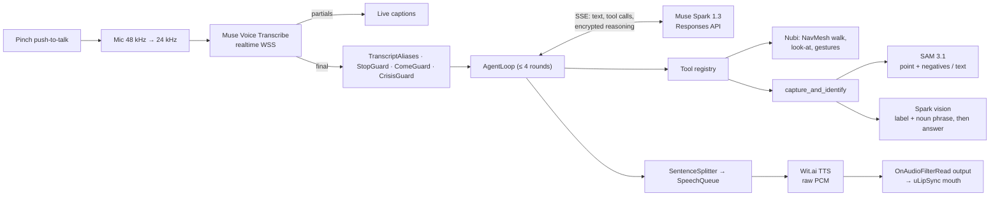
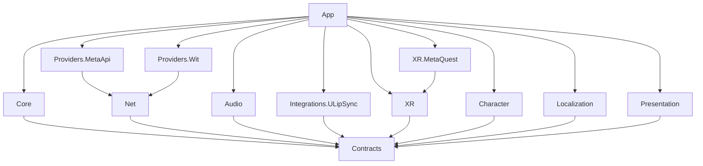

# Nubi

**A mixed-reality companion for Meta Quest 3 that walks around your room, looks at what you hold up, and talks you through using it, powered by Meta's Muse Spark, SAM 3.1 and Muse Voice Transcribe.**

<p align="center">
  
  
</p>

Open source (MIT). Unity 6.6 + OpenXR. Built for the Meta AI Developer Hackathon 2026, Indie track. The whole repository history falls inside the hackathon window (first commit 2026-11-01).

> **Demo video:** link added at submission (≤ 2:45; script in [`docs/demo-script.md`](docs/demo-script.md)).
> **Project status:** integrated and running on Quest 3. A scripted self-test runs the whole pipeline on the headset (real ASR → Spark → SAM → Wit → speaker) and reports latency and frame rate; see [Status](#status) and [Performance](#performance-budget).

`JollyXR` is the repository's codename. Nubi is an original character and is unrelated to Meta's "Jolly" mascot (see [Character](#character-and-the-jolly-question)).

---

## Contents

- [The problem](#the-problem)
- [Theme fit: Build for Your World](#theme-fit-build-for-your-world)
- [What it does](#what-it-does)
- [How Meta AI is used](#how-meta-ai-is-used-beyond-a-basic-integration)
- [Controls](#controls)
- [Architecture](#architecture)
- [Technical depth](#technical-depth)
- [Performance budget](#performance-budget)
- [Privacy and security](#privacy-and-security)
- [Accessibility](#accessibility) · [Localization](#localization)
- [Getting started](#getting-started)
- [Status](#status) · [Known limitations](#known-limitations) · [Roadmap](#roadmap)
- [License](#license) · [Decisions](#design-decisions) · [Credits](#credits)

---

## The problem

Many people live alone and get stuck on everyday physical tasks: an unfamiliar remote, a new coffee machine, a thermostat, a label they can't read. In the US, 26 % of adults 65 and older lived alone in 2023, and 38 % of those 85 and older ([Pew Research Center](https://www.pewresearch.org/short-reads/2025/12/04/a-smaller-share-of-older-us-adults-live-alone-today-than-in-1990/), from Census Bureau data). The help on offer today is either a person who isn't in the room, or a phone chatbot that can't see what you're holding and can't show you anything.

Nubi lives in your room. You talk to it, hold up an object, and point at it. Nubi outlines that exact object in your passthrough view, says what it is, and explains step by step how to use it. It also walks over when you call it, follows you to another room, and keeps you company. When the network drops, it doesn't go silent.

### Who benefits

| Who | What Nubi gives them |
|---|---|
| **Older adults living alone** (hero user) | A patient companion that comes when called and answers "how do I use this?" about the real object in their hand: a TV remote, a moka pot, a thermostat. |
| **Learners and new workers** | A Mentor persona that names a tool and walks through its steps while you hold it. |
| **Anyone who needs step-by-step help with a real object** | Answers about *this* object, outlined in the room, instead of a generic web search. |
| **Low-vision users** | Point at something and hear what it is, with large captions and an outline-plus-fill highlight. Quest 3 is not an assistive device today, so this group is best served by the glasses path in the [roadmap](#roadmap). |

Demo objects are always household items. Nubi is never demoed on medication.

### A day with Nubi

In the morning the TV remote won't do what you expect. You hold it up and ask "what is this, and which button turns it on?": Nubi outlines the remote, names it, and `highlight_part` outlines the power button on the same capture (PlayMode [`CaptureAndIdentify_SegmentsTheStillFrameAndSpeaksTheVisionAnswer`](JollyXR/Assets/Jolly/Tests/PlayMode/E2E/E2ETests.cs) and EditMode [`HighlightPart_UsesTheLastCaptureWithoutANewOne`](JollyXR/Assets/Jolly/Tests/EditMode/Core/Tools/FindAndHighlightToolTests.cs); `highlight_part` passed on the headset in the [`6f0383c` run](docs/perf/selftest-report.md#sam-text-prompt-tools-under-the-self-test-hand-debounce-6f0383c)). Later, "where are my glasses?": `find_object` outlines every match in view and Nubi looks at the nearest one ([`FindObject_OutlinesEveryInstanceAndLooksAtTheNearest`](JollyXR/Assets/Jolly/Tests/EditMode/Core/Tools/FindAndHighlightToolTests.cs); the model chose `find_object` for "where is my mug?" in 3 of 3 [`36778c1` runs](docs/perf/selftest-report.md#local-come-here-guard-and-reply-log-36778c1)). Standing by the sofa, "remember this place as the sofa" saves the spot with a spatial anchor, and "walk to the sofa" sends Nubi back there later ([`RememberPlace_SavesTheUsersFloorPositionWithAnAnchor`](JollyXR/Assets/Jolly/Tests/EditMode/Core/Tools/CharacterToolTests.cs), [`WalkTo_TaughtPlace_StartsMotionAndReturnsAtOnce`](JollyXR/Assets/Jolly/Tests/EditMode/Core/Tools/LocomotionToolTests.cs); EditMode only, not yet tried on a headset). When the Wi-Fi drops in the evening, "are you there?" still gets a spoken, lip-synced answer from a baked offline line ([`Offline_PressPlaysACannedLineWithoutTheCloud`](JollyXR/Assets/Jolly/Tests/PlayMode/E2E/E2ETests.cs); `offline_greeting` passed in 4 of 4 [`3e99cb5` runs](docs/perf/selftest-report.md#cartoon-voice-merged-character-voices-device-regression-fixes-3e99cb5)).

### Living with it

- **What a day costs.** Take 30 voice turns, 5 of them "what is this?" questions:
  - An average turn cost **$0.0042**: $0.0845 ÷ 20 for the 20-turn device run on `751acba`, which rotated greetings, "come here" and vision questions (6 of the 20) through ASR, Spark with tools, SAM and Spark vision ([report](docs/perf/selftest-report.md#stale-frames-are-device-state-not-the-build-or-heat-20-turn-latency-751acba)). 30 × $0.0042 = **$0.13**.
  - As a ceiling, price the 5 vision calls again on top at their worst case, **≤ $0.011** each: Spark vision ≤ 1.0k input tokens × $1.25/M = $0.0013 (~0.8–1.0k on the vision probes in [`api-spend.md`](docs/api-spend.md)), ≤ 1,024 output tokens (`visionMaxOutputTokens`) × $4.25/M = $0.0044, and 1–2 SAM images (a noun-phrase retry) × $0.0025 = ≤ $0.005. Prices: [`api-spend.md`](docs/api-spend.md).
  - Day: $0.126 + 5 × $0.011 = **≤ $0.18**, about $5.40 for 30 days. The default per-headset hard cap (`JollyConfig.hardCapUsd`, $20) covers over 100 such days before Nubi falls back to its offline lines. Cross-check: a default self-test run (six online voice turns, three of them vision tools) costs $0.020–0.028 on the app's meter ([`ee9b05c` runs](docs/perf/selftest-report.md#hedged-first-event-ee9b05c-b96a062)).
- **How it is meant to be used.** Short moments: put the headset on, hold up the remote or the moka pot, ask, hear the answer, take it off. A self-test run with eight scenarios takes about 2 minutes. Nubi is not designed for hours of wear.
- **Who sets it up.** A family member, once: Space Setup in the room Nubi lives in, the release APK installed, and their own API key pushed from a computer (`push-secrets.sh`; the Meta ToS forbids sharing a key, so each household brings its own; [Getting started](#getting-started)). After that the person at home only holds a pinch and talks.
- **The headset is the prototype, not the product.** Wearing a Quest 3 every morning is not what an older adult living alone will do. Glasses are the everyday form factor, and the brain is built to move there unchanged ([Why Quest today, glasses tomorrow](#why-quest-today-glasses-tomorrow)).

## Theme fit: Build for Your World

The theme, quoted from the event page:

> **Build for Your World.** Bring Meta's models into your domain. Solve a problem you know firsthand, free up time and mental space, and make something possible that wasn't before.

How Nubi fits it:
- **"Bring Meta's models into your domain."** Your domain here is literally your home. Muse Spark, SAM 3.1 and Muse Voice Transcribe run against your own room, your own objects and your own voice.
- **"Free up time and mental space."** You don't have to search for a manual. You hold the thing up and ask.
- **"Make something possible that wasn't before."** A language model gets a body that walks on a NavMesh baked from your scanned floor, and SAM gets a pointing hand as its prompt. A chat window can do neither.
- **Your world, not a floating overlay.** Nubi is mixed reality, not VR: it stands in your passthrough room, your furniture and your hands hide it when they are in front of it (Quest environment depth, with your Space Setup furniture as the fallback), and its contact shadow darkens your real floor (ADR-0024).

We read the rules and the rubric from the event page (`docs/research/hackathon.md`). The official *problem statements* that the Impact criterion refers to were not publicly available when we wrote this, so we don't quote one here. "Push the Frontier" targets robotics, science and industrial control. Nubi controls no physical system, so we did not enter it under that theme.

## What it does

The demo runs as six beats. The full shot list is in [`docs/demo-script.md`](docs/demo-script.md).

1. **"Nubi, come here."** You pinch and hold to talk. A live caption follows your words (with "Nubi", not "newbie"). When you let go, a local guard matches the short come request and starts the walk itself (ADR-0036), and Nubi answers with a baked "On my way!" (or "Coming!") with lip-sync and no model call (ADR-0037); questions get a short acknowledgement first, commands like this one do not (ADR-0040). Nubi walks around your furniture and stops about 1 m in front of you.
2. **"What is this, and which button turns it on?"** You hold up the TV remote and point at it. An outline appears on the real remote, the answer is spoken as it streams, then `highlight_part` outlines the power button itself. That is two SAM prompt types on one object: your pointing hand, then a text-prompted part. Tool badges show **SAM 3.1** and **Spark** firing.
3. **"Follow me." … "Stop."** Nubi follows you across the room and stops at once. "Stop" is matched on the device, before any model call.
4. **Barge-in.** You pinch in the middle of a long answer. The audio fades out within a 150 ms target (28–55 ms on the headset), and Nubi listens.
5. **Wi-Fi off.** "Are you there?" Nubi answers with a baked offline line, still lip-synced, and its idle behaviour carries on. Turn Wi-Fi back on and the next turn is online again.
6. **Cost.** The usage meter in Settings shows what the session cost, checked against [`docs/api-spend.md`](docs/api-spend.md).

**Built and tested but not in the main demo:**
- `find_object` ("where are my glasses?") highlights every match.
- `remember_place` and `walk_to("sofa")` use persisted anchors.
- **Your real furniture.** Nubi knows the couch, table, bed and chairs from Space Setup: "go sit by the couch" walks it to the couch's edge, facing it, and it looks at things in the room when it talks about them. Without Space Setup it says so once, stays within about 1.5 m of you, and opens Space Setup when you ask (ADR-0025).
- `set_persona` switches personas by voice.
- Gaze, open-palm and poke greetings (not yet confirmed with a person wearing the headset).

The full tool catalogue is in `JollyXR/Assets/Jolly/Runtime/Core/Tools`.

## Controls

Hands are the primary input; Touch controllers work too. Your tracked hands are drawn over passthrough as translucent hand meshes and disappear when tracking is lost; picking up a controller swaps that side to the controller model and its ray, and with the headset's automatic switching on, putting the controllers down brings your hands back (XRI Hands Interaction rig, [ADR-0030](docs/decisions/0030-hands-interaction-rig.md)).

| | Hands | Touch controllers |
|---|---|---|
| **Talk** (hold, release to send) | Pinch thumb and index finger and hold | Hold **A** (right) or **X** (left) |
| **Send Nubi somewhere** | Point the hand ray at the floor (a small ring appears) and pinch briefly | Point the ray at the floor and pull the trigger |
| **Interrupt Nubi** | Pinch again (with no ring showing) | Press A or X again |
| **Settings, buttons** | Point the hand ray and pinch, or poke the button with your index finger | Point the ray and pull the trigger |
| **Poke / greet Nubi** | Poke with the index finger, or hold an open palm toward Nubi | |

- **A pinch does not talk** while that hand's ray is on a button, or while your palm faces you (the Horizon OS menu gesture). Pinching while you point at Nubi does talk: the ray doesn't select Nubi, only a finger poke does. Settings → *PTT hand* limits pinch-to-talk to your dominant hand.
- **Settings appear only when you ask** (ADR-0042): turn your left palm toward you and press the small *Settings* button on the wrist, press ☰ on the left controller, or say "open settings". The panel opens in front of you and stays put; its X, a talk pinch, "close settings" or 20 s untouched close it.
- **The trigger never talks.** On the floor it moves Nubi; on a button it presses the button. It belongs to XRI's Activate action and UI press, and a runtime can report a hand pinch as a trigger; binding talk to it would skip the pinch checks above. The grip stays XRI's Select. A and X are bound to the Touch controller layouts by name, so no hand input can press them ([ADR-0021](docs/decisions/0021-controller-push-to-talk.md)).
- **Tap to move, hold to talk** ([ADR-0044](docs/decisions/0044-point-and-tap-to-move.md)). While the ring shows, a pinch shorter than 0.25 s sends Nubi there; hold it longer and you are talking. The microphone starts at the pinch, so a hold loses no words; a tap's audio is dropped on the headset and never sent to ASR or the model. With no ring (pointing at the air, a wall, a button or Nubi) a pinch talks at once, as before. The ring shows only on floor Nubi can walk to; pointing at a table top, couch seat or box top sends Nubi to the floor beside it, on the side you pointed at. Nubi turns to you when it arrives.
- **Moving doesn't interrupt.** A tap while Nubi speaks moves it and the reply carries on. To interrupt, pinch with no ring showing (or hold: a hold with the ring showing interrupts after 0.25 s).
- While a hand is tracked, that side's controller button and trigger are ignored, which is the same rule XRI's input modality manager uses.
- Holding a pinch and a button together counts as one press, so it can't interrupt your own turn.

## How Meta AI is used (beyond a basic integration)

| Meta capability | How Nubi uses it | Where |
|---|---|---|
| **Muse Spark 1.3, Responses API** | Streamed `POST /v1/responses` with `store:false`, `reasoning.effort:"minimal"`, flat function tools and `parallel_tool_calls`. Tool calls start executing **while the model is still streaming**. Spark's `phase:"commentary"` preamble is spoken before the tools finish, so you hear a reply straight away. Within a turn, every output item, including the **`reasoning.encrypted_content`** blobs, is replayed verbatim for the next round (up to 4 rounds). Interrupted turns commit `{"error":"interrupted"}` for unanswered calls, because the API rejects an orphan `function_call` with a 400 (verified live). | `Providers/MetaApi/Chat`, `Core/Agent` |
| **Spark as a body controller** | Locomotion tools (`come_here`, `follow_user`, `walk_to`, `go_to_surface`, `look_at`, `stop`, `play_gesture`) drive a NavMesh agent on the scanned floor, and the prompt lists the room's scanned furniture. They return as soon as motion starts, so a walk never holds a model round, and a barge-in never cancels a walk. | `Core/Tools/Locomotion`, `Character` |
| **SAM 3.1** | Three prompt types: a **point** from the hand ray projected into the passthrough camera image, with **negative points** from the tracked hand joints so your hand stays out of the mask; a **text** prompt (`find_object`, `highlight_part`, retries); and the image centre as a fallback. The masks are requested as `one_bit` and decoded by a **C# port of Meta's one-bit range decoder** (bit-exact against live masks; SAM License). | `Providers/MetaApi/Vision`, `Core/Tools/Vision` |
| **Spark vision driving SAM** | SAM and Spark run **in parallel** on the same frame. Spark streams a first line `LABEL\|NOUN_PHRASE`, then the spoken answer. If the first SAM mask looks implausible (empty, more than half the frame, or containing your hand), SAM is re-run once with Spark's noun phrase. SAM segments; Spark explains. We never claim SAM "recognises" anything. | `SparkObjectIdentifier`, `CaptureAndIdentifyTool` |
| **Muse Voice Transcribe, realtime** | `wss://api.meta.ai/v1/asr/realtime` over the BCL managed WebSocket, verified under IL2CPP on Quest 3. The socket opens at pinch *start*. Audio captured during the ~1 s handshake is sent all at once after the ack, then live. The final transcript arrives 166–208 ms after end-of-stream (device). | `Providers/MetaApi/Asr`, `Net/WebSockets` |
| **Wit.ai TTS** (Meta's speech service) | The Meta Model API has no text-to-speech, so speech output uses Wit `/synthesize` over raw HTTP (`audio/raw`, 24 kHz PCM) and streams sentence by sentence. No Voice SDK is involved. Nubi's voice is data: a `VoiceProfile` asset (Wit `Rubie`, pitch 110, picked by audition for a friendly cartoon sound that stays clear in long and sensitive talk), which every persona scales and the offline lines are baked from (ADR-0031). | `Providers/Wit` |
| **Model routing** | Requests that carry user speech, camera frames or memory derived from them go to **standard** `muse-spark-1.3`. Contributor models are used **only for synthetic CI and dev traffic**. Meta Model API ToS §6.2 says you "must not submit sensitive, confidential, or personal information" to Contributor services, so `MetaModelResolver` **throws** if a contributor id is used on the live-user route. It is real code, not an assert that gets stripped from release builds, and it has a test. | `Providers/MetaApi/Common` |
| **Cost control** | `ApiUsageMeter` reserves an estimate before every call and settles the actual usage (tokens, images, audio seconds) once. A request that would exceed the hard cap is refused, and Nubi switches to its offline lines (`BudgetReached`). | `Core/Usage` |

## Architecture

Ports and adapters. Interfaces live in `Jolly.Contracts`. Pure logic lives in `Jolly.Core`, which knows nothing about XR, Meta, Wit or scenes. Every vendor or platform sits in its own adapter assembly. Full design: [`docs/architecture.md`](docs/architecture.md). Interfaces: [`docs/contracts.md`](docs/contracts.md).

### A voice turn



### Assemblies

Each arrow is an allowed reference. An EditMode test (`AssemblyGraphTests`) loads every asmdef and fails the build on any other reference.



- **`Jolly.XR` is portable OpenXR** (AR Foundation, XR Hands, XRI). `Jolly.XR.MetaQuest` is the only assembly that names a Meta OpenXR type: the passthrough camera frame source and the Camera2 extrinsics.
- **Every AI provider sits behind an interface:** `IChatModel`, `ISpeechToText`, `ITextToSpeech`, `ISegmenter`, `IObjectIdentifier`, `IHealthProbe`. An on-device or LAN model (for example Muse Glimmer behind an OpenAI-compatible host) plugs in as one adapter, without touching Core. This is how the private and offline modes on the roadmap will work.
- **One plain composition root, no DI container and no singletons** (ADR-0009). CI greps for `FindObjectOfType`, `Resources.Load` and static `Instance`.

## Technical depth

- **Barge-in cancellation tree.** `appCts` → `sessionCts` (persona/locale) → `turnCts` (LLM stream, TTS requests, tools, ASR socket). A pinch cancels the turn first and then flushes audio with a 20 ms fade. Locomotion runs outside `turnCts`, so an interruption stops the talking, not the walking. `UnityWebRequest` aborts on the PlayerLoop.
- **Streaming audio output without `AudioClip`s.** `StreamingSpeechOutput` is a clip-less `AudioSource` whose `OnAudioFilterRead` pulls 24 kHz PCM from a ring and resamples it to the device rate. `Flush()` silences exactly what is playing, and "first sample played" is measured where the sample is actually consumed, not where it is read ahead. uLipSync sits after the filter on the same GameObject, so the mouth follows the audio you hear.
- **Lock-free SPSC ring** (`SpscFloatRing`) between the main thread and the audio thread: `Volatile` read/write, no locks and no allocations in the audio callback.
- **Allocation discipline.** Pooled 32 KB `DownloadHandlerScript` buffers for SSE and Wit (the parameterless constructor allocates per chunk), `ArrayPool`-backed `PcmChunk`s with idempotent dispose, reader-based JSON on hot paths, one persistent native camera buffer, and no LINQ, closures or string concatenation in `Update` or audio callbacks. The target is 0 B/frame at steady idle, enforced by the PlayMode test `NoGcAllocInSteadyStateIdle` on the real scene (no main-thread `GC.Alloc` sample over 120 idle frames); on the headset, 30 s of idle ran with 0 GC collections.
- **IL2CPP WebSocket.** The BCL's managed WebSocket works on Quest IL2CPP (measured: 469–652 ms cold TLS connect, 150 ms warm). The upgrade is done by our own code over `SslStream`, then `WebSocket.CreateFromStream`: Mono's `ClientWebSocket` read the upgrade response one byte per TLS read, at 16 KB of garbage each (ADR-0023). Receives resume on the main thread before writing to the channel, so every provider stream yields on the main thread.
- **Passthrough Camera Access.** The meta-openxr camera subsystem gives a 1728² YUV CPU image, converted straight to 640 px in 12–14 ms (75 ms at full resolution). Intrinsics match Camera2 `LENS_INTRINSIC_CALIBRATION` exactly. Extrinsics are read from Camera2 `LENS_POSE_*` over JNI (they are gyroscope-relative). Image timestamps are `CLOCK_MONOTONIC`, and the head pose is interpolated at that timestamp. The pixel ↔ world math (`CameraMath`) is EditMode-tested. Source: `docs/research/device-spike.md`.
- **Real-world occlusion without an extra draw.** AR Foundation's `ARShaderOcclusion` publishes Quest's per-eye environment depth; Nubi's own shaders reproject each fragment into it and write premultiplied colour with alpha = visibility, so a fragment behind your couch or your hand ends transparent and the passthrough shows through. Soft edges come from AR Foundation's depth preprocess. Without depth (unsupported runtime, stalled provider), boxes from Space Setup bounding boxes take over, drawn after Nubi and before the UI so they never hide captions or panels. The boxes need the same `USE_SCENE` permission, so with it denied nothing hides Nubi. The contact shadow fades and shrinks as both feet leave the floor (ADR-0024).
- **Runtime NavMesh sized for a living room.** Floor plane outlines are triangulated into mesh colliders, and bounding boxes are baked as Not Walkable (`NavMeshBuilder.BuildNavMeshData`, agent radius 0.15 m). `NavMeshSurface` would use the 0.5 m Humanoid agent, which erases a living room (ADR-0017). Rebuilds are throttled to once per 2 s.
- **Table-driven conversation state machine.** Three latched flags and per-state watchdogs. It is tested exhaustively, including every barge-in edge.
- **Safety and robustness.** `CrisisGuard` runs before the model, for every persona, and hands off deterministically. A persona's tool allow-list is enforced when a call executes, not only in the list sent to the model. `StopGuard` stops Nubi locally, and `ComeGuard` starts the walk on a short "come here" before the model (ADR-0036). Retries happen only before the first streamed byte, with full jitter and `Retry-After` capped at 8 s; a voice request still silent after 2.5 s is raced by an identical hedge request instead of retried after its timeout (ADR-0038). A five-state connectivity monitor (Online, Degraded, Offline, Unauthorized, BudgetReached) runs a backed-off health probe.
- **Quality gates** (`tools/ci/test.sh`): `-warnaserror+` on every assembly; no `async void`; no `System.Threading.Tasks.Task` (UniTask everywhere); no `CancellationTokenSource.CancelAfter` (it fires on a thread-pool timer); no debug-capture defines in shipped settings; a content validator for personas, string tables and line clips; line coverage of Core, Net, Providers and Audio at or above 91.6 % (`tools/ci/coverage.sh`). Current: **EditMode 1134/1134, PlayMode 379/379 plus one explicit live eval that runs only on request (with the local Jolly skin present; its one case skips on a clone without it), 92.7 % line coverage of that logic (84.8 % of all runtime code), zero compiler warnings, and an IL2CPP APK that builds.**
- **A self-checking pipeline on the headset.** `tools/device/selftest.sh` installs the release APK, arms a built-in self-test and runs eight scenarios with nobody wearing the headset. Bundled voice clips go through the real microphone pipeline to Muse ASR, Spark (with tools), SAM, Wit and the speaker. It also forces the network off and on, barges in, and samples frame time and render counters. It writes a PASS/DEGRADED/FAIL table and the run's API cost ([`docs/perf/selftest-report.md`](docs/perf/selftest-report.md), ADR-0018). It found bugs that no desk test could, including a health-probe URL that kept the app offline and a vision turn that ended in silence.

## Performance budget

Targets come from [`docs/definition-of-done.md`](docs/definition-of-done.md) §4–5. Stale-frame, memory and voice-latency rows come from `751acba` (cooled and rebooted headset, 20-turn run; report section "751acba"); the other measured values come from the on-device self-test of the full app on `main` at `3e99cb5` (Quest 3, Horizon OS v209, IL2CPP release build, three runs of the default build plus one of the Jolly build on 2026-11-01; [`docs/perf/selftest-report.md`](docs/perf/selftest-report.md), section "3e99cb5"), in a dim room with no Space Setup and nobody wearing the headset. Pinch → silence pools the `751acba`, `f311081` and `36778c1` sections. Rows that name an earlier pass come from that pass's section of the same report; the self-test does not measure them. Rows marked **unmeasured** need the OVR Metrics capture or a development-build Profiler session; the self-test report keeps the full DoD coverage table. Method: [`docs/perf/README.md`](docs/perf/README.md).

| Metric | Target | Measured |
|---|---|---|
| Frame rate (passthrough, Nubi visible) | ≥ 72 fps sustained | **72.0 fps** average, p95 frame 13.9 ms (30 s idle, 4 runs) |
| Stale frames | < 1 % over 10 min | **Met on a freshly rebooted headset except at launch.** After a reboot: turns **0.49–0.60 %**, idle **0.23–0.32 %**, whole run **0.93 %** over a 242 s 20-turn run and 1.77 % over a 106 s default run, whose ~90–110 launch stale frames are most of it. Before the reboot (4 days 14 h uptime), the same APK on a headset cooled for 20 min dropped 5.0 % idle and 6.2 % over the run, and OVR Metrics already counted stale frames during the Unity splash: device state, not the build or heat (ADR-0034). The 10-minute run is not done |
| Draw calls / SetPass | ≤ 200 / ≤ 60 | **17 / 15** per frame (idle) |
| Triangles | ≤ 300k scene; Nubi ≤ 30k | **33,744** per frame (idle); Nubi 25,248 tris, 2 materials, one 1024² texture (performance pass) |
| GC alloc | 0 B/frame idle; ≤ 4 KB/frame in a turn | idle: PlayMode gate `NoGcAllocInSteadyStateIdle` passes, and 0 GC collections in 30 s on the headset; per turn in a development player (fix/turn-gc): p50 **3.9 KB/frame**, max 6.4 (`barge_in`, **over**) |
| Memory | `app_rss_MB` ≤ 1,500 MB peak | `app_rss_MB` peak **642–643 MB** (OVR Metrics; `dumpsys meminfo` RSS 643–644 MB, PSS 463 MB); system used memory 546–562 MB idle (Jolly 567 MB) |
| CPU main thread, thermal, battery | p95 ≤ 11 ms; 30 min without throttling; ≤ 20 % per 30 min | unmeasured |
| **PTT release → first answer audio** | p50 ≤ 2.0 s | p50 **1,804 ms**, p90 2,577 ms, max 2,737 ms over **20 consecutive online turns** (greeting, `come_here`, vision, repeated; no wearer, so `selftest.sh --turns 20` stands in for LiveUser). Greetings are the slow ones (p50 2,362 ms, 6 of 7 over 2.0 s); the variance is model time, request → first text p50 1,277 ms, p90 2,068 ms, max 2,445 ms |
| PTT release → ASR final | p50 ≤ 300 ms | p50 **265 ms**, max 293 ms (20-turn run) |
| ASR final → first LLM text | p50 ≤ 1.3 s | p50 **1.28 s**, p90 2.07 s, max 2.45 s (request → first text in the 20-turn run; ASR final → request ≤ 5 ms) |
| Pinch → silence | p50 ≤ 150 ms | **28–55 ms** |
| Network loss → offline line | ≤ 2.0 s | offline line captioned **13–27 ms** after the press |
| `capture_and_identify` → mask visible | p50 ≤ 2.0 s | **614–1,349 ms** (bundled still image; the room was too dark for the live frame) |
| `capture_and_identify` → answer audio | p50 ≤ 2.5 s | **1,608–2,055 ms** (4 runs); in one run the Spark vision call failed on the network and the scenario FAILed |
| Camera frame → 640 px RGBA | — | **12–14 ms** convert, frame age 31–46 ms at acquire (device spike) |

## Privacy and security

- **No secrets in the APK, scene, assets or repo.** Keys live in `.env` in the editor and in `persistentDataPath/secrets.json` on the device, pushed over adb (ADR-0010); keep `.env` at `chmod 600`, and `push-secrets.sh` warns when it is not. `RedactingLog` masks key patterns, in messages and exception text, as a second layer of defence. The Meta ToS forbids sharing an API key, so each user brings their own. A server-side proxy is the production path.
- **`store:false`** on every Responses request.
- **No contributor models for user data.** This is enforced in code (see [model routing](#how-meta-ai-is-used-beyond-a-basic-integration)).
- **Camera frames are never written to disk.** They are Device User Data under Meta's [Developer Data Use Policy](https://developers.meta.com/vr/policy/data-use/) and go only to the Meta API. A frame lives in one reused native buffer, is encoded to JPEG in RAM, and is sent only when a vision tool runs. The only files the app writes are the conversation and scene memory, the usage totals and a random install id, all as JSON in app storage. Release builds contain no frame-capture code.
- **Transcripts and model text are not logged.** Log lines carry event names, ids and timings. The one exception is the adb-armed self-test, which has no person in it: it logs the first 120 characters of each model round (`evt=llm.reply`, ADR-0036). Should text logging ever be needed for debugging, the only allowed path is a `[Conditional("JOLLY_DEBUG_LOG")]` extension, which the compiler removes, with its arguments, from builds without that define.
- **`safety_identifier`** is a truncated SHA-256 of a random per-install GUID, never a hardware id.
- **Camera content is treated as data, not instructions.** Labels coming back from vision output are sanitised and placed in a user-role context block that is marked as untrusted.
- **Clear memory** in Settings deletes every persona's conversation file and the scene file, and erases the spatial anchors of taught places and seen objects from the headset. It waits for a running turn to end, so that turn can't write itself back. A replaced or forgotten place erases its anchor too.
- **The device self-test uses its own scratch memory**, so your summary never reaches a self-test request and its scripted turns never reach your memory.

## Accessibility

- **Captions** for both you and Nubi, on by default, in three text sizes.
- **Hands-only operation.** Push-to-talk works on either hand or on the dominant hand only. Controllers also work: hold A or X ([Controls](#controls)). Sending Nubi somewhere is point and pinch briefly, or point and pull the trigger, with a ring that is light with a dark rim, so it reads on any floor. Pinches are ignored while you hover UI or poke Nubi, and while your palm faces you (the system-menu gesture).
- **Seated mode.** Nubi comes to you, and the walking tools are withheld from the model.
- **Speech rate and volume settings.** The mask highlight uses an outline *and* a fill, so it doesn't rely on colour alone.

## Localization

Unity Localization 1.5.13, with locales `en` (default) and `pl`.
- The `UI`, `Lines`, `Personas` and `Crisis` string tables ship in English and Polish.
- ASR takes a language bias per locale.
- Wit has no Polish voice for this app (only `en_US`, `en_CA` and `en_GB` were listed), so Polish replies are captions-only.
- Baked offline lines are English today.
- Tool schemas stay in English because only the model reads them.
- The persona instructions get a language directive.

## Getting started

### Prerequisites

- **Unity 6000.6.6f1** with Android Build Support (OpenJDK, SDK and NDK from the Hub).
- **Git LFS.** The character FBX, textures, preview PNGs and baked audio are stored in LFS.
- **A Meta Quest 3** on Horizon OS ≥ v74 (we use v209) in **developer mode** (enable it in the Meta Horizon mobile app), connected over USB with `adb`.
- **Space Setup** done in the room you'll use. Nubi's NavMesh comes from the scanned floor and furniture. Without it Nubi walks only within about 1.5 m of you and offers to open Space Setup.
- **Accounts:** a Meta Model API key and a Wit.ai app (its client access token and app id).
- `python3`, used by `push-secrets.sh`.

### Build, install, run

```bash
git lfs install
git clone <this repo> && cd <this repo>
cp .env.example .env            # fill META_API_KEY, WIT_AI_CLIENT_TOKEN, WIT_AI_APP_ID (never commit .env)

tools/device/build.sh           # first build on a fresh checkout: applies Quest project settings in a separate
                                # editor session (Active Input Handling needs a restart), then builds
tools/ci/build.sh               # later builds: IL2CPP release APK → artifacts/Nubi.apk

tools/device/install-run.sh artifacts/Nubi.apk   # adb install -r -g, grants camera/mic/scene, launches
tools/device/push-secrets.sh    # .env → secrets.json on the headset (only the three device keys)
```

The app reads the secrets at launch, so `push-secrets.sh` stops it; start it again afterwards (`NUBI_SKIP_INSTALL=1 tools/device/install-run.sh`). Run it again after rotating a key. Without `secrets.json`, the app runs in offline mode and shows "API key missing".

### Tests

```bash
tools/ci/test.sh                # EditMode + PlayMode in batchmode with coverage, plus static gates; results in artifacts/
tools/ci/test.sh EditMode       # one platform (coverage is reported, not gated)
```

Line coverage per assembly goes to `artifacts/coverage-summary.txt`, the HTML report to `artifacts/coverage/Report/index.htm`.

No test touches the network. Providers are tested against SSE, ASR and SAM responses recorded from live calls (`Tests/Fixtures`), and everything else against hand-written fakes.

### On-device check

The scripted self-test runs the whole app on the headset without anyone wearing it (about 2 minutes and $0.02–0.03 of API calls per run):

```bash
NUBI_TMPDIR=<short temp dir> tools/device/selftest.sh   # --build to build first; exit 1 on any FAIL
```

It prints one row per scenario (offline line, two voice turns, `capture_and_identify`, `highlight_part`, `find_object`, barge-in, 30 s of idle performance), the compositor's stale-frame share and the run's cost. A dark room or a room without Space Setup shows up as DEGRADED, not FAIL. Only adb can arm it: it starts when `selftest.json` exists in the app's files folder, and the script writes that file. `tools/device/selftest.sh --turns 20` runs 20 consecutive online voice turns instead and prints release → first audio p50/p90/max with the stage breakdown (about $0.085).

During normal use, latency and readiness come from logfmt log lines:

```bash
adb logcat -G 16M && adb logcat -s Unity | grep -E "evt=(loc.ready|turn.latency)"
```

`evt=loc.ready table=… entries=N` shows that the localization tables came through Addressables. Each turn prints one `evt=turn.latency` line with its `PttReleased`, `AsrFinal`, `LlmFirstText`, `TtsFirstByte` and `FirstAudioPlayed` marks.

## Status

As of `main` at `0f2cef4` (2026-11-01), which is also the build of the last device run; the commits after it change only docs.

| Area | State |
|---|---|
| All subsystems (Net, Responses chat, usage meter, ASR, SAM + one-bit decoder, Spark vision, Wit TTS, streaming audio, conversation core, agent loop, tools, memory, offline mode, XR layer, Nubi, presentation, localization) | **Built and tested**: EditMode 1134/1134, PlayMode 379/379 (one explicit live eval skipped), pure-logic coverage 92.7 % |
| Composition root (`JollyBootstrap` → `AppGraph`), four personas, `JollyConfig`, `Lines`/`Personas` tables (en, pl), end-to-end PlayMode tests on the real scene, zero-GC idle gate | **Done** |
| Full app on Quest 3: voice turns, `capture_and_identify`, `highlight_part`, `find_object`, barge-in, offline lines, idle performance | **Verified by the on-device self-test.** Latest: one run of `0f2cef4` ([report](docs/perf/selftest-report.md#acknowledgement-only-for-questions-0f2cef4)), DEGRADED overall: `voice_come_here` PASS at 264 ms release → first audio (guard walk, canned line, no model request, no acknowledgement); `vision_highlight_part`, `vision_find_object`, offline, barge-in (28 ms) and idle PASS; the greeting (2.8 s, model time) and `capture_and_identify` (dark room, bundled still) DEGRADED. The 7 runs of `8bd9560`–`4fecc17` before it: the guard walked every time with no model request; 3 runs FAILed, never on come-here: two on a slow greeting (4.2–4.3 s of model time, `ee9b05c`; the second run also had the both-legs first-event stall, which ended in the spoken error line) and one on a network error during a vision call (`8bd9560`) |
| 20 consecutive voice turns (`selftest.sh --turns 20`, no wearer) | **Done** on `751acba`: release → first audio p50 **1,804 ms**, p90 **2,577 ms**, max 2,737 ms; greeting p50 2,362 ms ([report](docs/perf/selftest-report.md#stale-frames-are-device-state-not-the-build-or-heat-20-turn-latency-751acba)) |
| Walking on a scanned floor, the camera extrinsics marker test (≤ 3 cm at 1 m), mask placement in a lit room, pinch/gaze/palm/poke with a wearer, OVR Metrics and Profiler captures, 20 turns with a wearer (LiveUser) | **Pending** a session with a person in a lit room with Space Setup |

## Known limitations

- **Walking is unverified on a real floor.** The test room has no Space Setup. `come_here` now walks on the fallback disc there (ADR-0025), but walking on a scanned floor and to real furniture (`go_to_surface`) is tested only in PlayMode on a simulated room.
- **Only a short "come here" is handled on the device.** The model's own tool choice was unreliable: in the round 1 runs of `f311081` it answered in words without `come_here` in 2 of 3, and a text-only eval found `come_here` on 2 of 5 come phrasings at `minimal` effort ([tool-selection eval](docs/perf/tool-selection-eval.md), ADR-0035). `ComeGuard` therefore starts `come_here` on a short come request ("Nubi, come here", "Hi Nubi, come here", "come closer") as soon as the final arrives, and the turn ends with a baked ComingOver line and no model call (ADR-0036, ADR-0037): the guard walked and no model request was sent on that turn in all 7 device runs since `8bd9560`. That turn has no model-authored reply, so the greeting in "Hi Nubi, come here." is not answered in words. Longer requests ("come here and tell me about this remote") still depend on the model's choice.
- **Greetings are the slowest turn.** A greeting gets a full spoken answer and no tool: release → first audio was 3.0–3.3 s in all three `f311081` runs, 2.4–4.7 s in the `36778c1` runs, and p50 2,362 ms (6 of 7 over 2.0 s) in the 20-turn run. The time is model time (request → first text). The demo therefore opens with "Nubi, come here." and uses a greeting as its warm-up turn.
- **Without Space Setup, Nubi only knows the floor near you.** The fallback is a 1.5 m disc around the user at the tracking-origin floor height, stretched over to Nubi (up to 4 m); it does not know about a chair inside it. Re-reading planes after Space Setup by restarting the plane and box managers is unverified on the headset.
- **No perching.** Nubi stops at the edge of the couch or table and faces it; it cannot climb onto furniture (no NavMesh links or climb clips).
- **Interaction triggers and the pinch are unverified with a wearer.** With nobody wearing the headset, hand tracking produced phantom pinches, so the self-test drives push-to-talk itself.
- **Hand meshes, the hand ray and finger pokes on the Settings panel are unverified with a wearer.** The device log shows the hand subsystem running and the hand visuals bound (`evt=hands.subsystem`, `evt=hands.tracked`, `evt=hands.visual`); until ADR-0030 the scene had no hand objects at all, so hands drew nothing and could not press UI.
- **Point-and-tap is unverified with a wearer** (ADR-0044). The device self-test sends Nubi to a floor point with a scripted ray and a 100 ms pinch through the real tap/hold split, scene raycast, NavMesh and walk; the 0.25 s tap time, the ring's size and look, and how steady the hand ray stays through a pinch are for a person in the headset to judge. A hold that starts with the ring showing interrupts Nubi 0.25 s later than a pinch without it.
- **Controller push-to-talk is unverified on the headset.** Holding A or X is tested against the OpenXR device layouts in PlayMode, but no controller session has been run on the Quest.
- **One ~283 ms frame at launch**: a single synchronous call into Meta's OpenXR provider that starts the camera and creates the passthrough layer, which app code cannot defer or split (ADR-0032). The compositor loses ~36 frames around scene start in all. Starting the camera on the scene's first frame does not hide it: the Unity splash is already on screen, and the freeze only became one longer one (measured and reverted, ADR-0034).
- **Stale frames depend on the headset's uptime.** After a reboot, turns and idle are under 1 % (0.23–0.60 %) and a 20-turn run is 0.93 % overall; a short default run is 1.77 % because of the launch hitch. After 4 days of uptime the same build dropped 5 % idle on a cooled headset. Reboot the headset before a demo (ADR-0034). A 10-minute OVR Metrics run is still due.
- **GC during turns is at the budget, not under it everywhere.** p50 3.9 KB per frame in a development player (target ≤ 4 KB); a barge-in, with two ASR sessions in seconds, reaches 6.4 KB. Most of the rest is Mono's TLS stream allocating 16 KB per WebSocket read (ADR-0023).
- **A dark room gets a request for light, not an answer.** Below camera mean luma 25 (`JollyConfig.visionMinMeanLuma`), `capture_and_identify` and `find_object` make no SAM or Spark call and Nubi asks, in one sentence in its own voice, for a light or for the object closer to one (`too_dark`, ADR-0039). Every device room so far was this dark (mean luma 0.5–45; 0.8 in the [`4fecc17` run](docs/perf/selftest-report.md#dark-room-vision-guard-4fecc17)), so the self-test identifies its bundled still instead; the spoken too-dark reply is tested in EditMode only, not yet heard on the headset.
- **Vision answers vary with the model's reasoning.** Tool start → answer audio was 1.6–2.1 s in the last runs (1.6–3.4 s in earlier ones); the mask appears first (0.6–1.3 s) and a preamble covers the wait.
- **The first turn after launch is a little slower.** Connections opened at launch warm TLS for the ASR and Wit; when the acknowledgement still played at release on every turn, the first one took 1.1–1.4 s vs 0.6–1.1 s later, and the first sentence's audio starts 0.2–0.3 s after it is queued vs 0.1–0.35 s later.
- **Polish TTS is not available.** Polish replies are captions-only.
- **The camera pose is gyroscope-relative.** The mapping from that pose to the OpenXR head pose is still to be confirmed by the marker test. Until then, the mask overlay and pointing may be off by a few centimetres.
- **Responses sometimes sends nothing for a request.** In the four runs of ADR-0038, 1 of 39 voice model calls got no first event within 4 s (three in the `dd14847` runs, two in a row in one `36778c1` run). A voice request silent for 2.5 s is now hedged with an identical second request (ADR-0038), and a double stall ends in the error line after 4 s instead of ~8 s. In the first runs with the hedge, the one stall hit both requests (no first event on either by 4 s): that turn got the hold line and the canned error line ("Oops, something went wrong…"), not an answer. A double stall always ends in that spoken line (EditMode, through the real agent loop and hedge); the logs now say whether any byte arrived.
- **No server-side cancel for streaming responses.** A barge-in aborts the HTTP stream on the client and books an estimate of the aborted request.
- **Push-to-talk only.** Hands-free voice barge-in and a wake word were cut for the hackathon.
- **Real-world occlusion is unverified on the headset.** Environment-depth occlusion (furniture and hands in front of Nubi), its edge quality, the 4 cm floor bias and its GPU cost have not been seen or measured on a Quest yet; the Editor and the tests only exercise the fallback and the wiring.
- **Without environment depth, only furniture occludes.** The fallback uses Space Setup bounding boxes: no hands, no unscanned objects, and a box is larger than the furniture in it, so Nubi can be cut a little early near a couch's armrest.
- **The glasses path is unverified.** Passthrough Camera Access on Meta's glasses was not checked, so it is listed as roadmap only.

## Roadmap

These items are **not built.** They are where the architecture is designed to go.

- **Meta glasses.** The same brain (ASR → Spark tools → SAM → TTS) with a camera that already sees what you see. This is the natural form factor for low-vision help.
- **Android XR and Pico through OpenXR.** `Jolly.XR` is already free of Meta types, so a new platform needs a frame-source adapter beside `Jolly.XR.MetaQuest`. Note that the Meta SDK licence restricts its components to Meta hardware.
- **Offline and private models.** On-device STT and TTS, or a LAN host for open-weight Muse Glimmer (Apache-2.0) behind `IChatModel`, so nothing leaves the home.
- **A therapist-grade private mode.** The Listener persona (id `psychologist`) keeps no memory, uses no camera tools and gives a safety notice. A real counselling mode only makes sense once it runs on private models with professional review, so it is not demoed, and the app never calls it a psychologist.
- **Hands-free conversation.** Playback-gated VAD for voice barge-in, and a wake word.

### Why Quest today, glasses tomorrow

The brain does not depend on the headset: the asmdefs of `Jolly.Contracts`, `Jolly.Core`, `Jolly.Net`, `Jolly.Providers.MetaApi` and `Jolly.Providers.Wit` reference only each other and UniTask, no XR package, so the agent loop, tools, memory, ASR, Spark, SAM and Wit would carry over unchanged. A glasses build would need new adapters for the device edges declared in `Jolly.Contracts`: an `ICameraFrameSource` for the glasses camera (frames with intrinsics and a camera pose), an `IAudioCapture` and an `ISpeechOutput` for its microphones and speakers, and an `IUserPoseProvider` for where the wearer is. None of these adapters exists today. Quest 3 is the prototype because what makes Nubi mixed reality needs a world-locked display and room understanding: a body that walks a NavMesh baked from the real floor, the SAM mask drawn over the real object in passthrough, a hand ray as the pointing prompt, and depth occlusion.

## License

- **Our code:** [MIT](LICENSE).
- **Nubi** (the FBX, texture, face presets and preview renders generated by `tools/blender/build_nubi.py`): CC0, per ADR-0011.
- **Third-party components and their licences, including the non-OSI ones:** [`THIRD_PARTY.md`](THIRD_PARTY.md). The SAM one-bit decoder port is under the SAM License (`Runtime/Providers/MetaApi/Vision/LICENSE-SAM.txt`).

"Meta", "Muse", "Quest" and "SAM" are Meta's marks. We use them only to describe what this project calls. This project is not affiliated with or endorsed by Meta.

### Character and the Jolly question

The original idea used Meta's Muse mascot, Jolly. We found no licence for that model, and the hackathon rules require entrants to warrant that they infringe no copyright or trademark. So the mascot is **not in this repository**, and nothing derived from it is either. Nubi is an original character, generated entirely by a Python script, and designed to differ from Jolly in silhouette, colour, face and materials (see [`docs/art/nubi/README.md`](docs/art/nubi/README.md), ADR-0011).

Characters are data: a model, a face-preset file and a `CharacterDefinition` asset, selected at launch without code changes ([`docs/characters.md`](docs/characters.md), ADR-0026). Nubi is the default and the only committed character. Local characters live in a git-ignored folder, and a build includes one only when it is named explicitly.

## Design decisions

Thirty-seven ADRs (0001–0026, 0030–0040) record every key choice and its alternatives: [`docs/decisions/`](docs/decisions/README.md). Examples are OpenXR + meta-openxr instead of the Meta XR SDK (0002), Responses API routing (0004), Wit over raw HTTP (0006), a plain composition root (0009), secrets provisioning (0010) the integration deviations (0017) and the device self-test (0018). Review findings are in [`review-log.md`](docs/decisions/review-log.md). API spend is tracked call by call in [`docs/api-spend.md`](docs/api-spend.md), and is at most $1.96 of the $140 budget so far (row sum $1.962).

## Credits

- Built by Andrew Urbanovich, with Claude Code as a pair-programmer across parallel work packages.
- Meta Model API (Muse Spark, SAM 3.1, Muse Voice Transcribe) and Wit.ai.
- [UniTask](https://github.com/Cysharp/UniTask) by Cysharp, [uLipSync](https://github.com/hecomi/uLipSync) by hecomi, and Unity's OpenXR, AR Foundation, XR Hands, XRI and Localization packages, including the XRI *Starter Assets* and *Hands Interaction Demo* samples and the XR Hands *HandVisualizer* sample (hand rig, hand meshes and materials).
- Test images: "04-BICcristal2008-03-26.jpg" by Trounce (CC BY 3.0) and "Coffee Mug (Unsplash).jpg" by Ryan Holloway (CC0), via Wikimedia Commons.
