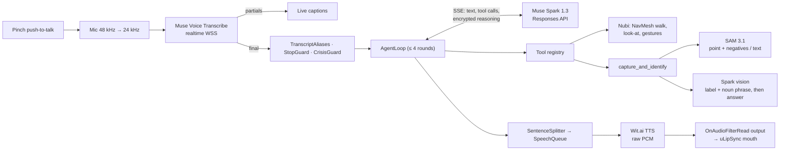
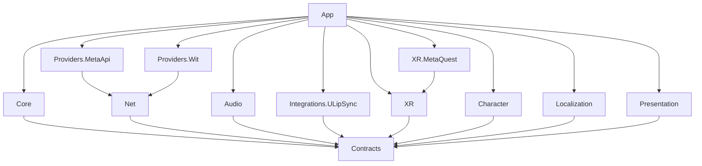

# Nubi

**A mixed-reality companion for Meta Quest 3 that walks around your room, looks at what you hold up, and talks you through using it, powered by Meta's Muse Spark, SAM 3.1 and Muse Voice Transcribe.**

<p align="center">
  
  
</p>

Open source (MIT). Unity 6.6 + OpenXR. Built for the Meta AI Developer Hackathon 2026, Indie track. The whole repository history falls inside the hackathon window (first commit 2026-11-01).

> **Demo video:** link added at submission (≤ 2:45; script in [`docs/demo-script.md`](docs/demo-script.md)).
> **Project status:** the subsystems are built and tested, and the end-to-end wiring is in progress. See [Status](#status) before you build.

`JollyXR` is the repository's codename. Nubi is an original character and is unrelated to Meta's "Jolly" mascot (see [Character](#character-and-the-jolly-question)).

---

## Contents

- [The problem](#the-problem)
- [Theme fit: Build for Your World](#theme-fit-build-for-your-world)
- [What it does](#what-it-does)
- [How Meta AI is used](#how-meta-ai-is-used-beyond-a-basic-integration)
- [Architecture](#architecture)
- [Technical depth](#technical-depth)
- [Performance budget](#performance-budget)
- [Privacy and security](#privacy-and-security)
- [Accessibility](#accessibility) · [Localization](#localization)
- [Getting started](#getting-started)
- [Status](#status) · [Known limitations](#known-limitations) · [Roadmap](#roadmap)
- [License](#license) · [Decisions](#design-decisions) · [Credits](#credits)

---

## The problem

Many people live alone and get stuck on everyday physical tasks: an unfamiliar remote, a new coffee machine, a thermostat, a label they can't read. The help on offer today is either a person who isn't in the room, or a phone chatbot that can't see what you're holding and can't show you anything.

Nubi lives in your room. You talk to it, hold up an object, and point at it. Nubi outlines that exact object in your passthrough view, says what it is, and explains step by step how to use it. It also walks over when you call it, follows you to another room, and keeps you company. When the network drops, it doesn't go silent.

### Who benefits

| Who | What Nubi gives them |
|---|---|
| **Older adults living alone** (hero user) | A patient companion that comes when called and answers "how do I use this?" about the real object in their hand: a TV remote, a moka pot, a thermostat. |
| **Learners and new workers** | A Mentor persona that names a tool and walks through its steps while you hold it. |
| **Anyone who needs step-by-step help with a real object** | Answers about *this* object, outlined in the room, instead of a generic web search. |
| **Low-vision users** | Point at something and hear what it is, with large captions and an outline-plus-fill highlight. Quest 3 is not an assistive device today, so this group is best served by the glasses path in the [roadmap](#roadmap). |

Demo objects are always household items. Nubi is never demoed on medication.

## Theme fit: Build for Your World

The theme, quoted from the event page:

> **Build for Your World.** Bring Meta's models into your domain. Solve a problem you know firsthand, free up time and mental space, and make something possible that wasn't before.

How Nubi fits it:
- **"Bring Meta's models into your domain."** Your domain here is literally your home. Muse Spark, SAM 3.1 and Muse Voice Transcribe run against your own room, your own objects and your own voice.
- **"Free up time and mental space."** You don't have to search for a manual. You hold the thing up and ask.
- **"Make something possible that wasn't before."** A language model gets a body that walks on a NavMesh baked from your scanned floor, and SAM gets a pointing hand as its prompt. A chat window can do neither.

We read the rules and the rubric from the event page (`docs/research/hackathon.md`). The official *problem statements* that the Impact criterion refers to were not publicly available when we wrote this, so we don't quote one here. "Push the Frontier" targets robotics, science and industrial control. Nubi controls no physical system, so we did not enter it under that theme.

## What it does

The demo runs as six beats. The full shot list is in [`docs/demo-script.md`](docs/demo-script.md).

1. **"Hi Nubi, come here."** You pinch and hold to talk. A live caption follows your words (with "Nubi", not "newbie"), you hear a short acknowledgement, and the answer starts streaming with lip-sync. Nubi walks around your furniture and stops about 1 m in front of you.
2. **"What is this, and how do I turn on subtitles?"** You hold up the TV remote and point at it. An outline appears on the real remote, the answer is spoken as it streams, Nubi looks at the object, and tool badges show **SAM 3.1** and **Spark** firing.
3. **"Follow me." … "Stop."** Nubi follows you across the room and stops at once. "Stop" is matched on the device, before any model call.
4. **Barge-in.** You pinch in the middle of a long answer. The audio fades out within a 150 ms target, Nubi listens, and a walk that was already in progress carries on.
5. **Wi-Fi off.** "Are you there?" Nubi answers with a baked offline line, still lip-synced, and its idle behaviour carries on. An open palm toward Nubi triggers a greeting. Turn Wi-Fi back on and the next turn is online again.
6. **Cost.** The usage meter in Settings shows what the session cost, checked against [`docs/api-spend.md`](docs/api-spend.md).

**Should-tier tools are built and tested but not yet in the demo:**
- `find_object` ("where are my glasses?") highlights every match.
- `highlight_part` ("which button is the guide?") works on the last capture.
- `remember_place` and `walk_to("sofa")` use persisted anchors.
- `set_persona` switches personas by voice.

The full tool catalogue is in `JollyXR/Assets/Jolly/Runtime/Core/Tools`.

## How Meta AI is used (beyond a basic integration)

| Meta capability | How Nubi uses it | Where |
|---|---|---|
| **Muse Spark 1.3, Responses API** | Streamed `POST /v1/responses` with `store:false`, `reasoning.effort:"minimal"`, flat function tools and `parallel_tool_calls`. Tool calls start executing **while the model is still streaming**. Spark's `phase:"commentary"` preamble is spoken before the tools finish, so you hear a reply straight away. Within a turn, every output item, including the **`reasoning.encrypted_content`** blobs, is replayed verbatim for the next round (up to 4 rounds). Interrupted turns commit `{"error":"interrupted"}` for unanswered calls, because the API rejects an orphan `function_call` with a 400 (verified live). | `Providers/MetaApi/Chat`, `Core/Agent` |
| **Spark as a body controller** | Locomotion tools (`come_here`, `follow_user`, `walk_to`, `look_at`, `stop`, `play_gesture`) drive a NavMesh agent on the scanned floor. They return as soon as motion starts, so a walk never holds a model round, and a barge-in never cancels a walk. | `Core/Tools/Locomotion`, `Character` |
| **SAM 3.1** | Three prompt types: a **point** from the hand ray projected into the passthrough camera image, with **negative points** from the tracked hand joints so your hand stays out of the mask; a **text** prompt (`find_object`, `highlight_part`, retries); and the image centre as a fallback. The masks are requested as `one_bit` and decoded by a **C# port of Meta's one-bit range decoder** (bit-exact against live masks; SAM License). | `Providers/MetaApi/Vision`, `Core/Tools/Vision` |
| **Spark vision driving SAM** | SAM and Spark run **in parallel** on the same frame. Spark streams a first line `LABEL\|NOUN_PHRASE`, then the spoken answer. If the first SAM mask looks implausible (empty, more than half the frame, or containing your hand), SAM is re-run once with Spark's noun phrase. SAM segments; Spark explains. We never claim SAM "recognises" anything. | `SparkObjectIdentifier`, `CaptureAndIdentifyTool` |
| **Muse Voice Transcribe, realtime** | `wss://api.meta.ai/v1/asr/realtime` over `ClientWebSocket`, verified under IL2CPP on Quest 3. The socket opens at pinch *start*. Audio captured during the ~1 s handshake is sent all at once after the ack, then live. The final transcript arrives 166–208 ms after end-of-stream (device). There is a file-endpoint fallback (`/v1/asr/transcribe`). | `Providers/MetaApi/Asr`, `Net/WebSockets` |
| **Wit.ai TTS** (Meta's speech service) | The Meta Model API has no text-to-speech, so speech output uses Wit `/synthesize` over raw HTTP (`audio/raw`, 24 kHz PCM) and streams sentence by sentence. No Voice SDK is involved. | `Providers/Wit` |
| **Model routing** | Requests that carry user speech, camera frames or memory derived from them go to **standard** `muse-spark-1.3`. Contributor models are used **only for synthetic CI and dev traffic**. Meta Model API ToS §6.2 says you "must not submit sensitive, confidential, or personal information" to Contributor services, so `MetaModelResolver` **throws** if a contributor id is used on the live-user route. It is real code, not an assert that gets stripped from release builds, and it has a test. | `Providers/MetaApi/Common` |
| **Cost control** | `ApiUsageMeter` reserves an estimate before every call and settles the actual usage (tokens, images, audio seconds) once. A request that would exceed the hard cap is refused, and Nubi switches to its offline lines (`BudgetReached`). | `Core/Usage` |

## Architecture

Ports and adapters. Interfaces live in `Jolly.Contracts`. Pure logic lives in `Jolly.Core`, which knows nothing about XR, Meta, Wit or scenes. Every vendor or platform sits in its own adapter assembly. Full design: [`docs/architecture.md`](docs/architecture.md). Interfaces: [`docs/contracts.md`](docs/contracts.md).

### A voice turn



### Assemblies

Each arrow is an allowed reference. An EditMode test (`AssemblyGraphTests`) loads every asmdef and fails the build on any other reference.



- **`Jolly.XR` is portable OpenXR** (AR Foundation, XR Hands, XRI). `Jolly.XR.MetaQuest` is the only assembly that names a Meta OpenXR type: the passthrough camera frame source and the Camera2 extrinsics.
- **Every AI provider sits behind an interface:** `IChatModel`, `ISpeechToText`, `ITextToSpeech`, `ISegmenter`, `IObjectIdentifier`, `IHealthProbe`. An on-device or LAN model (for example Muse Glimmer behind an OpenAI-compatible host) plugs in as one adapter, without touching Core. This is how the private and offline modes on the roadmap will work.
- **One plain composition root, no DI container and no singletons** (ADR-0009). CI greps for `FindObjectOfType`, `Resources.Load` and static `Instance`.

## Technical depth

- **Barge-in cancellation tree.** `appCts` → `sessionCts` (persona/locale) → `turnCts` (LLM stream, TTS requests, tools, ASR socket). A pinch cancels the turn first and then flushes audio with a 20 ms fade. Locomotion runs outside `turnCts`, so an interruption stops the talking, not the walking. `UnityWebRequest` aborts on the PlayerLoop.
- **Streaming audio output without `AudioClip`s.** `StreamingSpeechOutput` is a clip-less `AudioSource` whose `OnAudioFilterRead` pulls 24 kHz PCM from a ring and resamples it to the device rate. `Flush()` silences exactly what is playing, and "first sample played" is measured where the sample is actually consumed, not where it is read ahead. uLipSync sits after the filter on the same GameObject, so the mouth follows the audio you hear.
- **Lock-free SPSC ring** (`SpscFloatRing`) between the main thread and the audio thread: `Volatile` read/write, no locks and no allocations in the audio callback.
- **Allocation discipline.** Pooled 32 KB `DownloadHandlerScript` buffers for SSE and Wit (the parameterless constructor allocates per chunk), `ArrayPool`-backed `PcmChunk`s with idempotent dispose, reader-based JSON on hot paths, one persistent native camera buffer, and no LINQ, closures or string concatenation in `Update` or audio callbacks. The target is 0 B/frame at steady idle. The PlayMode gate that enforces it lands with integration ([Status](#status)).
- **IL2CPP WebSocket.** `System.Net.WebSockets.ClientWebSocket` works on Quest IL2CPP (measured: 469–652 ms cold TLS connect, 150 ms warm). Receives resume on the main thread before writing to the channel, so every provider stream yields on the main thread.
- **Passthrough Camera Access.** The meta-openxr camera subsystem gives a 1728² YUV CPU image, converted straight to 640 px in 12–14 ms (75 ms at full resolution). Intrinsics match Camera2 `LENS_INTRINSIC_CALIBRATION` exactly. Extrinsics are read from Camera2 `LENS_POSE_*` over JNI (they are gyroscope-relative). Image timestamps are `CLOCK_MONOTONIC`, and the head pose is interpolated at that timestamp. The pixel ↔ world math (`CameraMath`) is EditMode-tested. Source: `docs/research/device-spike.md`.
- **Runtime NavMesh sized for a living room.** Floor plane outlines are triangulated into mesh colliders, and bounding boxes are baked as Not Walkable (`NavMeshBuilder.BuildNavMeshData`, agent radius 0.15 m). `NavMeshSurface` would use the 0.5 m Humanoid agent, which erases a living room (ADR-0017). Rebuilds are throttled to once per 2 s.
- **Table-driven conversation state machine.** Three latched flags and per-state watchdogs. It is tested exhaustively, including every barge-in edge.
- **Safety and robustness.** `CrisisGuard` runs before the model and hands off deterministically. `StopGuard` stops Nubi locally. Retries happen only before the first streamed byte, with full jitter and `Retry-After` capped at 8 s. A five-state connectivity monitor (Online, Degraded, Offline, Unauthorized, BudgetReached) runs a backed-off health probe.
- **Quality gates** (`tools/ci/test.sh`): `-warnaserror+` on every assembly; no `async void`; no `System.Threading.Tasks.Task` (UniTask everywhere); no `CancellationTokenSource.CancelAfter` (it fires on a thread-pool timer); no debug-capture defines in shipped settings. At merge `8565f55`: **EditMode 881/881, PlayMode 196/196, zero compiler warnings, and an IL2CPP APK that builds.**

## Performance budget

Targets come from [`docs/definition-of-done.md`](docs/definition-of-done.md) §4–5. "Measured" values come from the Quest 3 device spike (Horizon OS v209, IL2CPP, 2026-11-01; [`docs/research/device-spike.md`](docs/research/device-spike.md)). That spike ran a near-empty scene, so it is **not** an app-level result. **TBD** values are filled from the on-device self-test and the OVR Metrics captures after integration. Method: [`docs/perf/README.md`](docs/perf/README.md).

| Metric | Target | Measured so far |
|---|---|---|
| Frame rate (passthrough, Nubi visible) | ≥ 72 fps sustained | 72/72 fps, near-empty scene (spike); app: **TBD** |
| GPU / CPU utilisation | headroom for 72 fps | 24 % / 13 % with app GPU ≈ 2.2 ms, near-empty scene; app: **TBD** |
| Stale frames | < 1 % over 10 min | **TBD** |
| Draw calls / SetPass | ≤ 200 / ≤ 60 | **TBD** |
| Triangles | ≤ 300k scene; Nubi ≤ 30k | Nubi **25,248** tris, 2 materials, one 1024² texture |
| GC alloc | 0 B/frame idle; ≤ 4 KB/frame in a turn | **TBD** (gate: `NoGcAllocInSteadyStateIdle`) |
| Memory (`app_rss_MB`) | ≤ 1,500 MB peak | **TBD** |
| Thermal / battery | 30 min, no throttling below 72 fps; ≤ 20 % per 30 min | **TBD** |
| PTT release → first answer audio | p50 ≤ 2.0 s | **TBD** (components below) |
| ASR final after end-of-stream | p50 ≤ 300 ms | **166–208 ms** (device) |
| Wit TTS first byte | p50 ≤ 400 ms | **465–800 ms** (device; Mac 341 ms), **at risk**, see [limitations](#known-limitations) |
| Pinch → silence | p50 ≤ 150 ms | **TBD** |
| Camera frame → 640 px RGBA | — | **12–14 ms** convert, frame age 31–46 ms at acquire |
| `capture_and_identify` → mask visible | p50 ≤ 2.0 s | SAM 416 ms warm, from device on a test image (n=1); **TBD** end to end |
| Spark vision first text | — | 1.51 s streamed at `minimal` (desk); 1.62 s non-streamed (device, n=1) |
| Network loss → offline line | ≤ 2.0 s | **TBD** |

## Privacy and security

- **No secrets in the APK, scene, assets or repo.** Keys live in `.env` in the editor and in `persistentDataPath/secrets.json` on the device, pushed over adb (ADR-0010). `RedactingLog` masks key patterns as a second layer of defence. The Meta ToS forbids sharing an API key, so each user brings their own. A server-side proxy is the production path.
- **`store:false`** on every Responses request.
- **No contributor models for user data.** This is enforced in code (see [model routing](#how-meta-ai-is-used-beyond-a-basic-integration)).
- **Camera frames are never written to disk.** A frame lives in one reused native buffer, is encoded to JPEG in RAM, and is sent only when a vision tool runs. The only files the app writes are the conversation and scene memory, the usage totals and a random install id, all as JSON in app storage. Release builds contain no frame-capture code.
- **Transcripts and model text are not logged in release builds.** That logging goes through a `[Conditional("JOLLY_DEBUG_LOG")]` extension, so the compiler removes the call and its arguments.
- **`safety_identifier`** is a truncated SHA-256 of a random per-install GUID, never a hardware id.
- **Camera content is treated as data, not instructions.** Labels coming back from vision output are sanitised and placed in a user-role context block that is marked as untrusted.
- **Clear memory** in Settings deletes the conversation and scene files.

## Accessibility

- **Captions** for both you and Nubi, on by default, in three text sizes.
- **Hands-only operation.** Push-to-talk works on either hand or on the dominant hand only. Pinches are ignored while you hover UI or poke Nubi, and while your palm faces you (the system-menu gesture). A controller button also works.
- **Seated mode.** Nubi comes to you, and the walking tools are withheld from the model.
- **Speech rate and volume settings.** The mask highlight uses an outline *and* a fill, so it doesn't rely on colour alone.

## Localization

Unity Localization 1.5.13, with locales `en` (default) and `pl`.
- The `UI` and `Crisis` string tables ship in English and Polish.
- ASR takes a language bias per locale.
- Wit has no Polish voice for this app (only `en_US`, `en_CA` and `en_GB` were listed), so Polish replies are captions-only.
- Baked offline lines are English today.
- Tool schemas stay in English because only the model reads them.
- The persona instructions get a language directive.

## Getting started

### Prerequisites

- **Unity 6000.6.6f1** with Android Build Support (OpenJDK, SDK and NDK from the Hub).
- **Git LFS.** The character FBX, textures, preview PNGs and baked audio are stored in LFS.
- **A Meta Quest 3** on Horizon OS ≥ v74 (we use v209) in **developer mode** (enable it in the Meta Horizon mobile app), connected over USB with `adb`.
- **Space Setup** done in the room you'll use. Nubi's NavMesh comes from the scanned floor and furniture.
- **Accounts:** a Meta Model API key and a Wit.ai app (its client access token and app id).
- `python3`, used by `push-secrets.sh`.

### Build, install, run

```bash
git lfs install
git clone <this repo> && cd <this repo>
cp .env.example .env            # fill META_API_KEY, WIT_AI_CLIENT_TOKEN, WIT_AI_APP_ID (never commit .env)

tools/device/build.sh           # first build on a fresh checkout: applies Quest project settings in a separate
                                # editor session (Active Input Handling needs a restart), then builds
tools/ci/build.sh               # later builds: IL2CPP release APK → artifacts/Nubi.apk

tools/device/install-run.sh artifacts/Nubi.apk   # adb install -r -g, grants camera/mic/scene, launches
tools/device/push-secrets.sh    # .env → secrets.json on the headset (only the three device keys)
```

Push the secrets before the first launch, or relaunch afterwards (`NUBI_SKIP_INSTALL=1 tools/device/install-run.sh`). Without `secrets.json`, the app runs in offline mode and shows "API key missing".

### Tests

```bash
tools/ci/test.sh                # EditMode + PlayMode in batchmode, plus static gates; results in artifacts/
tools/ci/test.sh EditMode       # one platform
```

No test touches the network. Providers are tested against SSE, ASR and SAM responses recorded from live calls (`Tests/Fixtures`), and everything else against hand-written fakes.

### On-device check

Latency and readiness come from logfmt log lines:

```bash
adb logcat -G 16M && adb logcat -s Unity | grep -E "evt=(loc.ready|turn.latency)"
```

`evt=loc.ready table=… entries=N` shows that the localization tables came through Addressables. Each turn prints one `evt=turn.latency` line with its `PttReleased`, `AsrFinal`, `LlmFirstText`, `TtsFirstByte` and `FirstAudioPlayed` marks. The scripted on-device self-test arrives with integration (WP9).

## Status

As of merge `8565f55` (2026-11-02). This section is updated as integration lands.

| Area | State |
|---|---|
| Net, Responses chat, usage meter, ASR (realtime + file), SAM + one-bit decoder, Spark vision, Wit TTS, streaming audio, conversation core and agent loop, tools, memory, offline mode, XR layer (permissions, PTT, camera, NavMesh, anchors, interaction signals), Nubi character, presentation views, localization | **Built and tested** (881 EditMode + 196 PlayMode tests) |
| Transport on Quest 3: IL2CPP WebSocket ASR, Wit TTS, passthrough CPU image + intrinsics + extrinsics, SAM and Spark called from the device | **Verified on device** (spike, 2026-11-01) |
| Composition root (`JollyBootstrap`), persona assets, `JollyConfig`, `Lines`/`Personas` tables, end-to-end PlayMode tests, zero-GC gate | **In progress** (WP9) |
| Camera extrinsics marker test (≤ 3 cm at 1 m), lit-room SAM quality, lip-sync on device, end-to-end latency p50, OVR Metrics captures | **Pending** the headset session |

## Known limitations

- **Wit TTS first-byte latency on the device (0.5–0.8 s)** is above the 400 ms stage budget. The answer still starts streaming before the full reply exists, but the 2 s first-audio target is at risk until it is measured end to end.
- **Polish TTS is not available.** Polish replies are captions-only.
- **The camera pose is gyroscope-relative.** The mapping from that pose to the OpenXR head pose is still to be confirmed by the marker test. Until then, the mask overlay and pointing may be off by a few centimetres.
- **No server-side cancel for streaming responses.** A barge-in aborts the HTTP stream on the client and books an estimate of the aborted request.
- **Push-to-talk only.** Hands-free voice barge-in and a wake word were cut for the hackathon.
- **The glasses path is unverified.** Passthrough Camera Access on Meta's glasses was not checked, so it is listed as roadmap only.

## Roadmap

These items are **not built.** They are where the architecture is designed to go.

- **Meta glasses.** The same brain (ASR → Spark tools → SAM → TTS) with a camera that already sees what you see. This is the natural form factor for low-vision help.
- **Android XR and Pico through OpenXR.** `Jolly.XR` is already free of Meta types, so a new platform needs a frame-source adapter beside `Jolly.XR.MetaQuest`. Note that the Meta SDK licence restricts its components to Meta hardware.
- **Offline and private models.** On-device STT and TTS, or a LAN host for open-weight Muse Glimmer (Apache-2.0) behind `IChatModel`, so nothing leaves the home.
- **A therapist-grade private mode.** The Psychologist persona is designed with no memory persistence and a deterministic crisis hand-off. It only makes sense once it runs on private models with professional review, so it is not demoed.
- **Hands-free conversation.** Playback-gated VAD for voice barge-in, and a wake word.

## License

- **Our code:** [MIT](LICENSE).
- **Nubi** (the FBX, texture, face presets and preview renders generated by `tools/blender/build_nubi.py`): CC0, per ADR-0011.
- **Third-party components and their licences, including the non-OSI ones:** [`THIRD_PARTY.md`](THIRD_PARTY.md). The SAM one-bit decoder port is under the SAM License (`Runtime/Providers/MetaApi/Vision/LICENSE-SAM.txt`).

"Meta", "Muse", "Quest" and "SAM" are Meta's marks. We use them only to describe what this project calls. This project is not affiliated with or endorsed by Meta.

### Character and the Jolly question

The original idea used Meta's Muse mascot, Jolly. We found no licence for that model, and the hackathon rules require entrants to warrant that they infringe no copyright or trademark. So the mascot is **not in this repository**, and nothing derived from it is either. Nubi is an original character, generated entirely by a Python script, and designed to differ from Jolly in silhouette, colour, face and materials (see [`docs/art/nubi/README.md`](docs/art/nubi/README.md), ADR-0011).

## Design decisions

Seventeen ADRs record every key choice and its alternatives: [`docs/decisions/`](docs/decisions/README.md). Examples are OpenXR + meta-openxr instead of the Meta XR SDK (0002), Responses API routing (0004), Wit over raw HTTP (0006), a plain composition root (0009), secrets provisioning (0010) and the integration deviations (0017). Review findings are in [`review-log.md`](docs/decisions/review-log.md). API spend is tracked call by call in [`docs/api-spend.md`](docs/api-spend.md), and is under $1 of the $140 budget so far.

## Credits

- Built by Andrew Urbanovich, with Claude Code as a pair-programmer across parallel work packages.
- Meta Model API (Muse Spark, SAM 3.1, Muse Voice Transcribe) and Wit.ai.
- [UniTask](https://github.com/Cysharp/UniTask) by Cysharp, [uLipSync](https://github.com/hecomi/uLipSync) by hecomi, and Unity's OpenXR, AR Foundation, XR Hands, XRI and Localization packages.
- Test images: "04-BICcristal2008-03-26.jpg" by Trounce (CC BY 3.0) and "Coffee Mug (Unsplash).jpg" by Ryan Holloway (CC0), via Wikimedia Commons.
